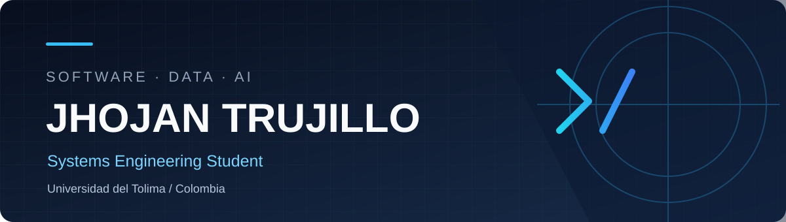

  

<h1 align="center">¡Hola! Soy Jhojan Trujillo 👋</h1>

  Estudiante de Ingeniería de Sistemas en la Universidad del Tolima 🇨🇴 
  Construyo software y exploro la visión por computador, los datos y la inteligencia artificial.

  <a href="https://github.com/Trujillol123?tab=repositories">Repositorios</a> ·
  <a href="#-proyectos-destacados">Proyectos</a> ·
  <a href="#-tecnolog%C3%ADas-y-herramientas">Tecnologías</a>

---

## 👨‍💻 Sobre mí

Soy **Jhojan Stiven Trujillo García**, estudiante de Ingeniería de Sistemas. Me interesa crear aplicaciones útiles y aprender a partir de proyectos reales. En mis repositorios encontrarás desarrollo de escritorio con Java, herramientas en Python y un proyecto de control por gestos que combina visión por computador e interfaces gráficas.

> Me gusta entender cómo funciona un sistema, construirlo paso a paso y documentar lo aprendido.

## 🧰 Tecnologías y herramientas

**Lenguajes y bases de datos**

**Aplicaciones e inteligencia artificial**

**Datos y flujo de trabajo**

## 🚀 Proyectos destacados

| Proyecto | Qué construí | Tecnologías |
| :-- | :-- | :-- |
| [Control por gestos](https://github.com/Trujillol123/gesture-control-system) | Sistema experimental para reconocer movimientos de la mano y controlar el cursor, con interfaz de escritorio. | Python · OpenCV · MediaPipe · TensorFlow · PySide6 |
| [Gestión de tienda de zapatos](https://github.com/Trujillol123/GESTION-DE-VENTAS-Y-COMPRAS-TIENDA-DE-ZAPATOS) | Aplicación académica para gestionar productos, compras, ventas y clientes. | Java · Swing · MySQL · Maven |
| [Ecuaciones diferenciales](https://github.com/Trujillol123/ecuaciones_diferenciales) | Herramienta en Python para clasificar ecuaciones y mostrar el proceso de resolución. | Python |

## 📚 Lo que estoy explorando

- **Visión por computador:** captura de cámara, seguimiento de manos e interacción por gestos.
- **Desarrollo de software:** interfaces, lógica de negocio y persistencia de datos.
- **Análisis de datos:** visualización y comunicación de hallazgos con herramientas como Power BI.

---

  <strong>Aprendiendo, construyendo y mejorando proyecto a proyecto.</strong> 
  <a href="https://github.com/Trujillol123?tab=repositories">Explora mis repositorios →</a>

