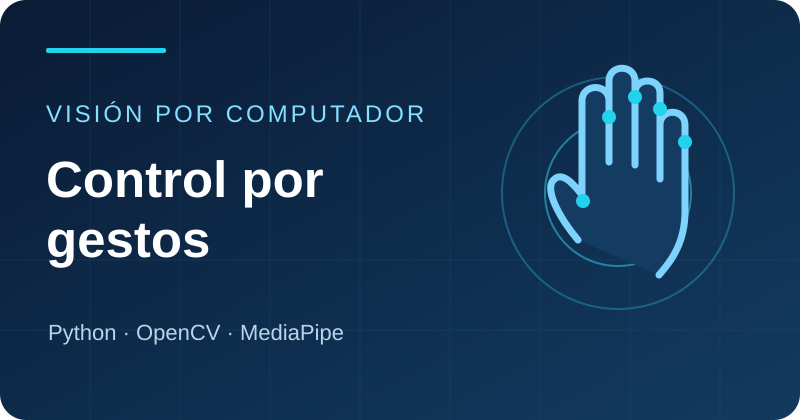
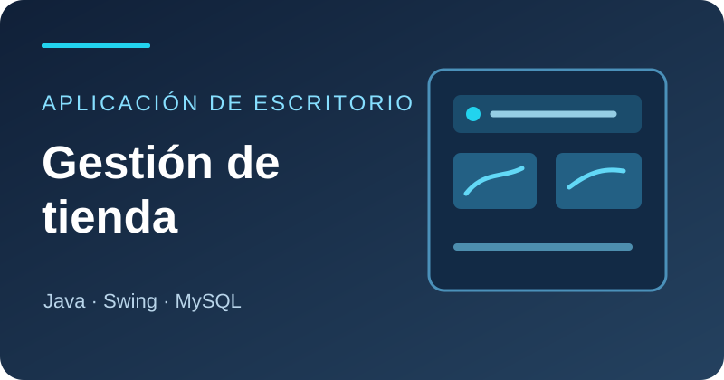
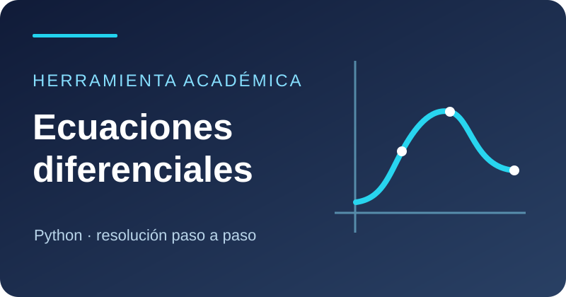

  

<h1 align="center">¡Hola! Soy Jhojan Trujillo 👋</h1>

  Ingeniería de Sistemas · Universidad del Tolima 
  Java y MySQL para gestión comercial · Python y visión por computador para control por gestos

  
  

---

## 👨‍💻 Sobre mí

Soy **Jhojan Stiven Trujillo García**. En mi proyecto de [gestión de una tienda de zapatos](https://github.com/Trujillol123/GESTION-DE-VENTAS-Y-COMPRAS-TIENDA-DE-ZAPATOS) trabajé con productos, clientes, compras y ventas usando **Java, Swing y MySQL**. En [control por gestos](https://github.com/Trujillol123/gesture-control-system) integro cámara, seguimiento de manos e inferencia para mover el cursor con **Python, OpenCV, MediaPipe y TensorFlow**.

También tengo en desarrollo un [prototipo académico de ecuaciones diferenciales](https://github.com/Trujillol123/ecuaciones_diferenciales) con un menú para clasificación, teoría e historial de ejercicios.

## 🧰 Tecnologías y herramientas

  

| Área | Herramientas que he usado |
| :-- | :-- |
| **Programación y datos** | Python, Java, SQL, MySQL y Power BI |
| **Visión por computador e IA** | OpenCV, MediaPipe y TensorFlow |
| **Interfaces y desarrollo** | PySide6, Java Swing, Maven, Git y GitHub |

## 🚀 Proyectos destacados

<table>
  <tr>
    <td width="50%" valign="top">
      
      
Reconocimiento de movimientos de la mano para controlar el cursor con una interfaz de escritorio.

      
<a href="https://github.com/Trujillol123/gesture-control-system"><strong>Explorar el código →</strong></a>

    </td>
    <td width="50%" valign="top">
      
      
Aplicación académica para gestionar productos, compras, ventas y clientes de una tienda de zapatos.

      
<a href="https://github.com/Trujillol123/GESTION-DE-VENTAS-Y-COMPRAS-TIENDA-DE-ZAPATOS"><strong>Explorar el código →</strong></a>

    </td>
  </tr>
  <tr>
    <td colspan="2" valign="top" align="center">
      
      
<strong>Prototipo en desarrollo:</strong> menú en Python para clasificación, teoría e historial de ecuaciones diferenciales.

      
<a href="https://github.com/Trujillol123/ecuaciones_diferenciales"><strong>Explorar el código →</strong></a>

    </td>
  </tr>
</table>

---

  <strong>Java · Python · MySQL · Visión por computador</strong> 
  <a href="https://github.com/Trujillol123?tab=repositories">Explora mis repositorios</a> ·
  <a href="https://www.linkedin.com/in/jhojan-trujillo-56975413a/">Conectemos en LinkedIn</a>

